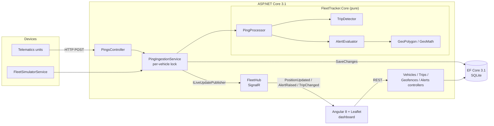
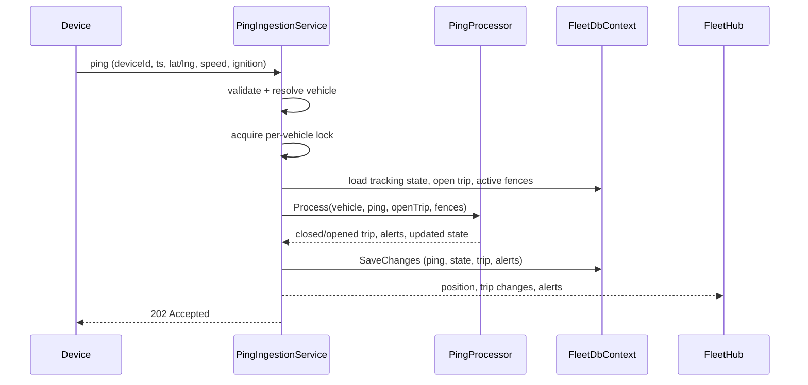

# Fleet Tracker

**Live vehicle tracking for small fleets: GPS ping ingestion, geofences, automatic trip detection and real-time alerts on a Leaflet map.**

[](https://github.com/alexgeorghiou/fleet-tracker-netcore/actions/workflows/ci.yml)
[](LICENSE)


Built on the ASP.NET Core 3.1 / Angular 8 stack. Telematics units (or the built-in simulator) POST position
reports; the server segments them into trips, evaluates geofence/overspeed/idle rules incrementally, stores
everything with EF Core and pushes updates to every open dashboard over SignalR.

## Features

- **GPS ingestion** – `POST /api/pings` for single reports and `/api/pings/batch` for buffered bursts after a
  unit regains signal. Validation rejects null-island fixes, out-of-range speeds/headings and future timestamps.
  Late (out-of-order) pings are stored for history but never rewind live state.
- **Geofences** – arbitrary polygons with even-odd ray casting, a bounding-box fast path, boundary-inclusive
  semantics and an area sanity check. Per-fence enter/exit alert toggles and an active flag.
- **Trip detection** – an incremental state machine: a trip starts on ignition + movement and ends on ignition
  off, a stationary dwell (back-dated to when the vehicle actually stopped), or a signal gap (closed at the last
  known fix). Distance, max/average speed and ping count are tracked as pings arrive.
- **Alerts** – edge-triggered rules: geofence enter/exit, overspeed with hysteresis and severity escalation,
  and idling with ignition on. Alerts are listed, filtered and acknowledged via the API.
- **Live map** – Angular 8 + Leaflet dashboard with heading-rotated markers, colour-coded status, fading trails,
  geofence overlays, a vehicle list, an alert feed and a trip history panel that draws a selected trip's route.
- **Real-time** – strongly-typed SignalR hub (`/hubs/fleet`) with fleet-wide and per-vehicle groups and
  automatic client reconnect.
- **Simulator** – a background service drives four seeded vehicles around Amsterdam through the *real*
  ingestion pipeline, so trips, idles, fence crossings and overspeeds happen without hardware.
- **Device key** – optional shared-secret header (`X-Device-Key`) for ingestion, compared in constant time.
- Swagger UI, health check endpoint, Docker image that serves API and SPA from one container.

## Architecture



Ping hot path:



## Quickstart

### Docker (API + dashboard, simulator on)

```bash
docker compose up --build
# dashboard: http://localhost:8080   swagger: http://localhost:8080/swagger
```

### Local development

Requires the .NET Core 3.1 SDK and Node 12.

```bash
# API on http://localhost:5000 (simulator is enabled in Development)
dotnet run --project src/FleetTracker.Api

# Angular dev server on http://localhost:4200, proxying /api and /hubs to the API
cd client
npm install
npm start
```

### Tests

```bash
dotnet test
```

The suite covers the geometry, trip state machine, alert rules, ingestion service (against real SQLite files,
including concurrent pings) and the HTTP surface via `WebApplicationFactory`.

> Running on a machine that only has a newer .NET runtime? `DOTNET_ROLL_FORWARD=Major dotnet test` runs the
> 3.1 test host on it.

Example requests live in [`docs/requests.http`](docs/requests.http).

## Configuration

| Key | Default | Meaning |
| --- | --- | --- |
| `ConnectionStrings:Fleet` | `Data Source=fleet.db` | SQLite database file |
| `Tracking:MovingSpeedThresholdKph` | `5` | At or above this the vehicle is moving |
| `Tracking:StationaryTripEnd` | `00:05:00` | Stationary dwell that closes a trip |
| `Tracking:MaxPingGap` | `00:10:00` | Silence that closes a trip at the last fix |
| `Tracking:IdleAlertAfter` | `00:03:00` | Ignition-on idle time before an alert |
| `Tracking:OverspeedHysteresisKph` | `5` | Drop below limit needed to re-arm overspeed |
| `Simulator:Enabled` | `false` (`true` in Development) | Run the built-in fleet simulator |
| `Ingestion:DeviceApiKey` | empty | When set, ingestion requires `X-Device-Key` |
| `Cors:Origins` | `http://localhost:4200` | Allowed dashboard origins |

## Project structure

```
FleetTracker.sln
├── src/
│   ├── FleetTracker.Core/            # Domain + pure tracking logic, no I/O
│   │   ├── Geo/                      # GeoPoint, GeoMath (haversine), GeoPolygon (ray casting)
│   │   ├── Domain/                   # Vehicle, GpsPing, Trip, Geofence, Alert, VehicleTrackingState
│   │   ├── Tracking/                 # TripDetector, AlertEvaluator, PingProcessor, options
│   │   └── Abstractions/             # IClock, ILiveUpdatePublisher, hub payloads
│   ├── FleetTracker.Infrastructure/  # EF Core DbContext, converters, seeding, ingestion service
│   └── FleetTracker.Api/             # Controllers, SignalR hub, simulator, Startup
├── tests/FleetTracker.Tests/         # xUnit: unit, SQLite-backed service and HTTP integration tests
├── client/                           # Angular 8 + Leaflet + @microsoft/signalr dashboard
├── docs/requests.http
├── Dockerfile / docker-compose.yml
└── .github/workflows/ci.yml
```

## Design decisions and trade-offs

- **Incremental, not batch, trip detection.** Each vehicle keeps a small `VehicleTrackingState` row (last fix,
  open trip, dwell/idle timers, current fence membership). A ping is evaluated in O(fences) without replaying
  history. The trade-off is that late pings cannot retroactively change trips; they are stored and flagged
  instead, which is the behaviour most dispatch views want.
- **Pure core, thin shell.** `TripDetector`, `AlertEvaluator` and `PingProcessor` only mutate objects they are
  handed. All I/O lives in `PingIngestionService`, which makes the rules exhaustively unit-testable and
  would let the same core run inside a queue consumer.
- **Edge-triggered alerts.** Rules fire on transitions (outside → inside, under → over limit) so a vehicle
  sitting in a fence or cruising fast does not flood the feed. Overspeed uses a hysteresis band to avoid
  flapping around the limit; the first fix never raises enter/exit because there is no "before".
- **Per-vehicle serialisation.** A keyed `SemaphoreSlim` guarantees pings for one vehicle are applied in order
  while different vehicles run in parallel. This is single-node only; scaling out would partition by device
  id on a broker (Kafka/RabbitMQ consistent hashing) so each vehicle has one consumer.
- **Planar ray casting over spatial types.** City-scale fences are well served by an equirectangular
  approximation, and storing vertices as a compact text column keeps the schema portable (SQLite today,
  SQL Server/PostgreSQL later) without NetTopologySuite. Fences crossing the antimeridian are out of scope.
- **SQLite + `EnsureCreated`** keeps the demo zero-setup. A production deployment would use migrations and a
  server database, and would move raw pings to a time-series store with retention.
- **Publishing never fails ingestion.** Data is committed before fan-out; a SignalR hiccup is logged and the
  device still gets `202 Accepted`.
- **Era-appropriate stack.** The project deliberately stays on `netcoreapp3.1`, EF Core 3.1 and Angular 8 with
  their idioms (`Startup`, `IHostBuilder`, View Engine, `HubConnectionBuilder`). CI builds the API inside the
  official 3.1 SDK container because current hosted runners lack the OpenSSL 1.1 that 3.1 needs.

## Roadmap

- EF Core migrations and a SQL Server/PostgreSQL profile
- Per-device credentials instead of a shared key
- Geofence drawing/editing on the map (Leaflet.draw)
- Speed-limit lookup per road segment instead of per vehicle
- Client unit tests (Karma/Jasmine) and an end-to-end smoke test against the container
- Trip replay with a time slider

## License

[MIT](LICENSE) © 2026 Alex Georghiou
